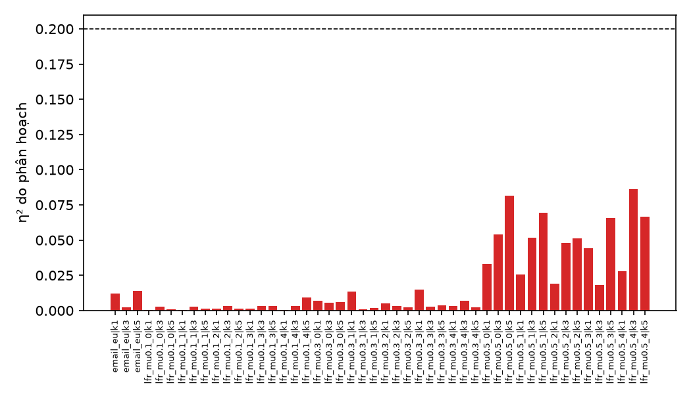
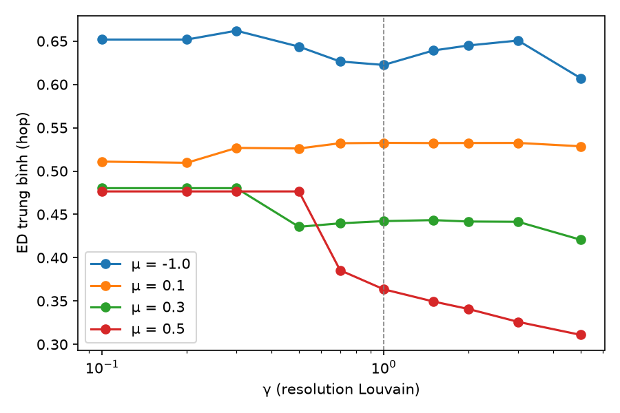

# Báo cáo thí nghiệm tiền đề H0

Ngày tạo: 03/11/2026 10:04 · Sinh tự động bởi `analyze_h0.py` từ CSV thô trong `results/raw/`.

Căn cứ: Review 30/10 Mục 7.1, 7.2, 7.3; QĐ11; QĐ12. Giao thức: `H0_PROTOCOL.md` (hash trong `H0_PROTOCOL.sha256`).

## Phần 1. Tóm tắt (bản nộp GVHD)

**Kết luận đề xuất: NO-GO.** H-a đạt trên **0/16** đồ thị (ngưỡng ≥ 11). H-b: **4/16** đồ thị có |ρ(NMI, ED)| < 0.5 → không đạt (cần đa số).

Theo 30/10 Mục 7.6, nếu GVHD xác nhận NO-GO: giữ truy vết, chuyển sang D1 (ước lượng số nguồn bằng cộng đồng) hoặc D2 (đặt monitor theo cộng đồng).

### 1.1. Thiết lập

| Thành phần | Thiết lập |
|---|---|
| Đồ thị | 15 LFR (n = 1.000; μ ∈ {0,1; 0,3; 0,5}) + email-Eu-core |
| Phân hoạch | Louvain 10 γ × 5 seed = 50/đồ thị; mặc định γ = 1, seed 0 |
| Lan truyền | IC chạy đến hết, snapshot đầy đủ; giữ cascade có 10–20% node nhiễm; k ∈ {1, 3, 5}; 200 cascade test + 50 val mỗi cấu hình |
| Bộ định vị | B2 CommJordan (k-center trên đồ thị con nhiễm của từng cộng đồng, ngưỡng ρ chọn trên val theo ED); đối chứng Jordan center, LPSI |
| Metric | ED (Hungarian, min(|Ŝ|,|S|) cặp); |k̂ − k| và F1@h báo cáo riêng |

### 1.2. H-a theo từng đồ thị

Một đồ thị đạt khi đạt ở ≥ 2/3 giá trị k. Một cặp (đồ thị, k) đạt khi Δ_crossfit ≥ 0,3 hop **hoặc** ≥ 10% ED mặc định, **và** η² ≥ 0,20.

| Đồ thị | μ | k | ED mặc định | ED tốt nhất (γ) | Δ cross-fit | η² | |k̂−k| mặc định | Đạt |
|---|---|---|---|---|---|---|---|---|
| email_eu | -1.0 | 1 | 0.69 | 0.60 (5) | 0.08 | 0.01 | 37.7 | ✗ |
| email_eu | -1.0 | 3 | 0.59 | 0.59 (5) | -0.02 | 0.00 | 36.9 | ✗ |
| email_eu | -1.0 | 5 | 0.56 | 0.55 (0.7) | -0.03 | 0.01 | 32.0 | ✗ |
| lfr_mu0.1_0 | 0.1 | 1 | 0.64 | 0.60 (0.3) | 0.02 | 0.00 | 56.1 | ✗ |
| lfr_mu0.1_0 | 0.1 | 3 | 0.50 | 0.46 (0.2) | 0.02 | 0.00 | 54.2 | ✗ |
| lfr_mu0.1_0 | 0.1 | 5 | 0.48 | 0.44 (0.2) | 0.04 | 0.00 | 53.2 | ✗ |
| lfr_mu0.1_1 | 0.1 | 1 | 0.62 | 0.58 (5) | -0.02 | 0.00 | 58.7 | ✗ |
| lfr_mu0.1_1 | 0.1 | 3 | 0.52 | 0.46 (0.2) | 0.04 | 0.00 | 55.7 | ✗ |
| lfr_mu0.1_1 | 0.1 | 5 | 0.46 | 0.42 (0.2) | 0.02 | 0.00 | 52.7 | ✗ |
| lfr_mu0.1_2 | 0.1 | 1 | 0.58 | 0.56 (0.2) | -0.04 | 0.00 | 59.2 | ✗ |
| lfr_mu0.1_2 | 0.1 | 3 | 0.50 | 0.45 (0.2) | 0.04 | 0.00 | 53.4 | ✗ |
| lfr_mu0.1_2 | 0.1 | 5 | 0.46 | 0.43 (0.2) | 0.02 | 0.00 | 55.5 | ✗ |
| lfr_mu0.1_3 | 0.1 | 1 | 0.61 | 0.56 (0.1) | 0.01 | 0.00 | 52.1 | ✗ |
| lfr_mu0.1_3 | 0.1 | 3 | 0.53 | 0.48 (0.2) | 0.04 | 0.00 | 55.8 | ✗ |
| lfr_mu0.1_3 | 0.1 | 5 | 0.50 | 0.45 (0.2) | 0.04 | 0.00 | 50.8 | ✗ |
| lfr_mu0.1_4 | 0.1 | 1 | 0.52 | 0.49 (0.2) | -0.02 | 0.00 | 55.8 | ✗ |
| lfr_mu0.1_4 | 0.1 | 3 | 0.54 | 0.49 (0.2) | 0.03 | 0.00 | 56.5 | ✗ |
| lfr_mu0.1_4 | 0.1 | 5 | 0.52 | 0.46 (0.1) | 0.07 | 0.01 | 52.3 | ✗ |
| lfr_mu0.3_0 | 0.3 | 1 | 0.48 | 0.41 (5) | 0.01 | 0.01 | 72.2 | ✗ |
| lfr_mu0.3_0 | 0.3 | 3 | 0.39 | 0.37 (5) | 0.00 | 0.01 | 66.3 | ✗ |
| lfr_mu0.3_0 | 0.3 | 5 | 0.39 | 0.33 (5) | 0.06 | 0.01 | 70.9 | ✗ |
| lfr_mu0.3_1 | 0.3 | 1 | 0.47 | 0.43 (5) | -0.02 | 0.01 | 72.5 | ✗ |
| lfr_mu0.3_1 | 0.3 | 3 | 0.45 | 0.43 (5) | 0.00 | 0.00 | 69.6 | ✗ |
| lfr_mu0.3_1 | 0.3 | 5 | 0.43 | 0.41 (0.5) | 0.01 | 0.00 | 71.5 | ✗ |
| lfr_mu0.3_2 | 0.3 | 1 | 0.48 | 0.44 (0.7) | 0.01 | 0.01 | 72.9 | ✗ |
| lfr_mu0.3_2 | 0.3 | 3 | 0.43 | 0.41 (0.5) | 0.00 | 0.00 | 72.1 | ✗ |
| lfr_mu0.3_2 | 0.3 | 5 | 0.44 | 0.39 (5) | 0.02 | 0.00 | 66.4 | ✗ |
| lfr_mu0.3_3 | 0.3 | 1 | 0.51 | 0.47 (1) | -0.01 | 0.01 | 69.1 | ✗ |
| lfr_mu0.3_3 | 0.3 | 3 | 0.44 | 0.41 (0.5) | 0.02 | 0.00 | 65.5 | ✗ |
| lfr_mu0.3_3 | 0.3 | 5 | 0.40 | 0.37 (0.5) | 0.01 | 0.00 | 66.2 | ✗ |
| lfr_mu0.3_4 | 0.3 | 1 | 0.48 | 0.39 (5) | 0.04 | 0.00 | 72.0 | ✗ |
| lfr_mu0.3_4 | 0.3 | 3 | 0.40 | 0.36 (5) | 0.03 | 0.01 | 69.9 | ✗ |
| lfr_mu0.3_4 | 0.3 | 5 | 0.40 | 0.36 (0.5) | 0.03 | 0.00 | 68.1 | ✗ |
| lfr_mu0.5_0 | 0.5 | 1 | 0.47 | 0.33 (1.5) | 0.10 | 0.03 | 89.2 | ✗ |
| lfr_mu0.5_0 | 0.5 | 3 | 0.32 | 0.28 (3) | 0.01 | 0.05 | 77.5 | ✗ |
| lfr_mu0.5_0 | 0.5 | 5 | 0.33 | 0.27 (5) | 0.06 | 0.08 | 79.3 | ✗ |
| lfr_mu0.5_1 | 0.5 | 1 | 0.42 | 0.32 (5) | 0.02 | 0.03 | 83.5 | ✗ |
| lfr_mu0.5_1 | 0.5 | 3 | 0.33 | 0.24 (5) | 0.04 | 0.05 | 83.7 | ✗ |
| lfr_mu0.5_1 | 0.5 | 5 | 0.32 | 0.25 (5) | 0.08 | 0.07 | 80.1 | ✗ |
| lfr_mu0.5_2 | 0.5 | 1 | 0.43 | 0.34 (5) | 0.03 | 0.02 | 86.4 | ✗ |
| lfr_mu0.5_2 | 0.5 | 3 | 0.34 | 0.26 (5) | 0.08 | 0.05 | 82.4 | ✗ |
| lfr_mu0.5_2 | 0.5 | 5 | 0.33 | 0.26 (5) | 0.05 | 0.05 | 77.0 | ✗ |
| lfr_mu0.5_3 | 0.5 | 1 | 0.41 | 0.33 (5) | 0.02 | 0.04 | 88.1 | ✗ |
| lfr_mu0.5_3 | 0.5 | 3 | 0.37 | 0.31 (5) | 0.04 | 0.02 | 79.2 | ✗ |
| lfr_mu0.5_3 | 0.5 | 5 | 0.34 | 0.26 (5) | 0.04 | 0.07 | 77.5 | ✗ |
| lfr_mu0.5_4 | 0.5 | 1 | 0.39 | 0.32 (3) | 0.01 | 0.03 | 89.0 | ✗ |
| lfr_mu0.5_4 | 0.5 | 3 | 0.37 | 0.28 (3) | 0.07 | 0.09 | 88.3 | ✗ |
| lfr_mu0.5_4 | 0.5 | 5 | 0.34 | 0.27 (5) | 0.04 | 0.07 | 85.4 | ✗ |



### 1.3. H-b: NMI và ED

| Đồ thị | μ | Spearman ρ(NMI, ED) | Khoảng NMI | |ρ| < 0,5 |
|---|---|---|---|---|
| email_eu | -1.0 | -0.53 | -0.00–0.76 | ✗ |
| lfr_mu0.1_0 | 0.1 | 0.72 | -0.00–1.00 | ✗ |
| lfr_mu0.1_1 | 0.1 | 0.84 | -0.00–1.00 | ✗ |
| lfr_mu0.1_2 | 0.1 | 0.44 | 0.00–1.00 | ✓ |
| lfr_mu0.1_3 | 0.1 | 0.72 | 0.00–1.00 | ✗ |
| lfr_mu0.1_4 | 0.1 | 0.81 | -0.00–1.00 | ✗ |
| lfr_mu0.3_0 | 0.3 | -0.57 | 0.00–0.94 | ✗ |
| lfr_mu0.3_1 | 0.3 | -0.47 | 0.00–0.97 | ✓ |
| lfr_mu0.3_2 | 0.3 | -0.48 | 0.00–0.95 | ✓ |
| lfr_mu0.3_3 | 0.3 | -0.53 | 0.00–0.95 | ✗ |
| lfr_mu0.3_4 | 0.3 | -0.38 | 0.00–0.96 | ✓ |
| lfr_mu0.5_0 | 0.5 | -0.96 | 0.00–0.41 | ✗ |
| lfr_mu0.5_1 | 0.5 | -0.97 | 0.00–0.46 | ✗ |
| lfr_mu0.5_2 | 0.5 | -0.97 | 0.00–0.50 | ✗ |
| lfr_mu0.5_3 | 0.5 | -0.95 | 0.00–0.46 | ✗ |
| lfr_mu0.5_4 | 0.5 | -0.99 | 0.00–0.40 | ✗ |



### 1.4. Các cách đọc khác của H-a (báo cáo phụ, không dùng kết luận)

| Cách đọc | Số đồ thị đạt |
|---|---|
| Chính: Δ cross-fit, "hoặc", η² trên tổng phương sai | 0 |
| Δ đơn giản (chọn và đo trên cùng cascade) | 0 |
| "và" thay cho "hoặc" | 0 |
| Vế 2 theo 04/10: SS_phân hoạch / SS_cascade ≥ 0,20 | 0 |

### 1.5. Kiểm tra hợp lý

- Cây ngẫu nhiên n = 500, k = 1: Jordan center ED trung bình **6.82** hop, ED = 0 ở 3% cascade → **không đạt** (tiêu chí ED TB ≤ 1).
- Phân hoạch ngẫu nhiên ED TB **0.18** so với Louvain **0.50** → **không đạt** (ngẫu nhiên lại tốt hơn — xem Phần 4).

### 1.6. So sánh bộ định vị (trung bình theo μ, k)

| μ | k | Phương pháp | ED | |k̂−k| | F1@1 | Tỉ lệ nhiễm |
|---|---|---|---|---|---|---|
| -1.0 | 1 | commjordan | 0.72 | 38.9 | 0.21 | 0.161 |
| -1.0 | 1 | jordan | 0.77 | 31.5 | 0.15 | 0.161 |
| -1.0 | 1 | lpsi | 0.99 | 29.0 | 0.11 | 0.161 |
| -1.0 | 1 | random_part | 0.45 | 76.4 | 0.20 | 0.161 |
| -1.0 | 3 | commjordan | 0.62 | 37.7 | 0.36 | 0.165 |
| -1.0 | 3 | jordan | 0.62 | 30.9 | 0.28 | 0.165 |
| -1.0 | 3 | lpsi | 0.76 | 27.6 | 0.21 | 0.165 |
| -1.0 | 3 | random_part | 0.34 | 76.6 | 0.34 | 0.165 |
| -1.0 | 5 | commjordan | 0.58 | 33.2 | 0.49 | 0.147 |
| -1.0 | 5 | jordan | 0.56 | 26.4 | 0.41 | 0.147 |
| -1.0 | 5 | lpsi | 0.69 | 24.3 | 0.32 | 0.147 |
| -1.0 | 5 | random_part | 0.32 | 67.0 | 0.47 | 0.147 |
| 0.1 | 1 | commjordan | 0.59 | 57.0 | 0.06 | 0.149 |
| 0.1 | 1 | jordan | 0.59 | 57.7 | 0.06 | 0.149 |
| 0.1 | 1 | lpsi | 1.22 | 23.9 | 0.07 | 0.149 |
| 0.1 | 1 | random_part | 0.13 | 128.9 | 0.08 | 0.149 |
| 0.1 | 3 | commjordan | 0.51 | 55.7 | 0.16 | 0.150 |
| 0.1 | 3 | jordan | 0.48 | 56.4 | 0.14 | 0.150 |
| 0.1 | 3 | lpsi | 1.08 | 22.9 | 0.17 | 0.150 |
| 0.1 | 3 | random_part | 0.10 | 127.7 | 0.17 | 0.150 |
| 0.1 | 5 | commjordan | 0.48 | 53.5 | 0.23 | 0.148 |
| 0.1 | 5 | jordan | 0.46 | 54.1 | 0.22 | 0.148 |
| 0.1 | 5 | lpsi | 1.07 | 21.7 | 0.25 | 0.148 |
| 0.1 | 5 | random_part | 0.09 | 124.6 | 0.24 | 0.148 |
| 0.3 | 1 | commjordan | 0.51 | 69.5 | 0.06 | 0.149 |
| 0.3 | 1 | jordan | 0.57 | 62.7 | 0.05 | 0.149 |
| 0.3 | 1 | lpsi | 1.01 | 35.1 | 0.06 | 0.149 |
| 0.3 | 1 | random_part | 0.11 | 131.1 | 0.06 | 0.149 |
| 0.3 | 3 | commjordan | 0.44 | 66.6 | 0.14 | 0.147 |
| 0.3 | 3 | jordan | 0.46 | 60.0 | 0.13 | 0.147 |
| 0.3 | 3 | lpsi | 0.91 | 33.5 | 0.14 | 0.147 |
| 0.3 | 3 | random_part | 0.09 | 126.8 | 0.15 | 0.147 |
| 0.3 | 5 | commjordan | 0.41 | 66.3 | 0.21 | 0.150 |
| 0.3 | 5 | jordan | 0.42 | 59.3 | 0.19 | 0.150 |
| 0.3 | 5 | lpsi | 0.92 | 32.3 | 0.21 | 0.150 |
| 0.3 | 5 | random_part | 0.08 | 127.4 | 0.22 | 0.150 |
| 0.5 | 1 | commjordan | 0.46 | 81.0 | 0.05 | 0.154 |
| 0.5 | 1 | jordan | 0.56 | 65.9 | 0.05 | 0.154 |
| 0.5 | 1 | lpsi | 1.00 | 39.1 | 0.05 | 0.154 |
| 0.5 | 1 | random_part | 0.18 | 123.8 | 0.06 | 0.154 |
| 0.5 | 3 | commjordan | 0.38 | 76.1 | 0.13 | 0.147 |
| 0.5 | 3 | jordan | 0.45 | 61.5 | 0.12 | 0.147 |
| 0.5 | 3 | lpsi | 0.88 | 36.7 | 0.13 | 0.147 |
| 0.5 | 3 | random_part | 0.15 | 116.9 | 0.14 | 0.147 |
| 0.5 | 5 | commjordan | 0.35 | 74.2 | 0.21 | 0.147 |
| 0.5 | 5 | jordan | 0.42 | 59.7 | 0.19 | 0.147 |
| 0.5 | 5 | lpsi | 0.88 | 35.1 | 0.20 | 0.147 |
| 0.5 | 5 | random_part | 0.14 | 114.8 | 0.22 | 0.147 |

## Phần 2. Vì sao chọn các tham số này

Nhãn: **[Cô]** lấy nguyên từ Review 30/10; **[Bắt buộc]** cô không nêu nhưng code cần; **[Chọn]** lựa chọn có thể đổi.

| Tham số | Giá trị | Nguồn | Lý do |
|---|---|---|---|
| LFR n, μ, số đồ thị | 1.000; {0,1; 0,3; 0,5}; 5/μ | [Cô] | 30/10 Mục 7.3 |
| LFR τ₁, τ₂, bậc TB, bậc max, cỡ cộng đồng | 3; 1,5; 10; 50; 20–100 | [Bắt buộc] | Hàm LFR cần đủ tham số; dùng mức phổ biến trong tài liệu (Lancichinetti et al. 2008) |
| Thành phần liên thông lớn nhất | Có | [Bắt buộc] | Node rời không có đường đi → không tính được ED |
| email-Eu-core | Bỏ hướng, bỏ self-loop, LCC; phòng ban = cộng đồng thật | [Cô] + [Bắt buộc] | Cô yêu cầu đồ thị có cộng đồng thật cho H-b |
| Lưới γ | 0.1, 0.2, 0.3, 0.5, 0.7, 1, 1.5, 2, 3, 5 | [Chọn] | Cô yêu cầu 10 giá trị, gợi ý thang log 0,1–5; lưới phải chứa đúng γ = 1 để có phân hoạch mặc định |
| Seed phân hoạch | 0–4 | [Cô] | 10 γ × 5 seed |
| Sinh phân hoạch trước cascade | Có, lưu hash | [Cô] | Chống rò rỉ: phân hoạch không phụ thuộc cascade |
| Phân hoạch ngẫu nhiên | 5, giữ phân bố kích thước của mặc định | [Cô] + [Chọn số lượng] | Mức sàn |
| Mô hình lan truyền | IC chạy đến hết, snapshot đầy đủ | [Cô] | 30/10 Mục 7.3 |
| Đạt 10–20% nhiễm | Chọn p tối đa hóa tỉ lệ cascade trong 10–20%, chỉ giữ cascade trong khoảng | [Bắt buộc] | IC có chuyển pha: không p nào cho trung vị trong 10–20% (chạy thử) |
| k | 1, 3, 5 | [Cô] | 30/10 Mục 7.3 |
| Số cascade | 200 test + 50 val | [Cô] + [Chọn val] | Cô: 200 cascade; val cần để chốt ρ (30/10 Mục 7.1: tham số chốt trên val) |
| Ngưỡng ρ của B2 | {1..6} hop, chọn theo ED trên val | [Chọn] | Cô yêu cầu ngưỡng nhưng không nêu lưới; ED là metric chính của cô |
| k-center | Greedy Gonzalez (xấp xỉ 2) | [Bắt buộc] | k-center là NP-hard |
| Khoảng cách cho k-center | Trên đồ thị con nhiễm; mảnh rời xử lý riêng | [Cô] | 30/10 Mục 7.1: bán kính trên đồ thị con nhiễm |
| Khoảng cách cho ED | Trên toàn đồ thị G | [Cô] | ED = số hop giữa nguồn đoán và nguồn thật |
| Jordan center (k > 1) | Cùng k-center, ρ riêng chọn trên val | [Chọn] | Jordan cổ điển chỉ cho 1 nguồn |
| LPSI | α = 0,5; nguồn = cực đại địa phương dương | [Chọn theo bài gốc] | Wang et al., AAAI 2017 |
| Δ cross-fit | Chọn trên nửa cascade, đo trên nửa kia | [Chọn] | Tránh thổi phồng khi lấy max trên 50 phân hoạch; Δ đơn giản báo cáo phụ |
| Đơn vị đạt | Đồ thị đạt khi ≥ 2/3 k đạt; GO khi ≥ 2/3 đồ thị | [Cô] + [Chọn] | Cô nói ≥ 2/3 đồ thị; mỗi đồ thị có 3 giá trị k nên cần quy tắc gộp |
| Seed | 2026 (chính), 9999 (chạy thử) | [Chọn] | Tái lập; chạy thử không nhìn trước dữ liệu chính |

## Phần 3. Code làm gì

| File | Vai trò |
|---|---|
| `config.py` | Toàn bộ tham số ở Phần 2; khóa hash cùng giao thức |
| `h0lib.py` | Sinh LFR, tải email-Eu-core; Louvain; mô phỏng IC; `CommJordan` (B2), `jordan_global`, `LPSI`; chấm ED/F1 |
| `run_h0.py` | Bước PREPARE (đồ thị + phân hoạch) rồi RUN (cascade, định vị, chấm điểm), ghi CSV thô từng đồ thị; chạy tiếp được khi bị ngắt |
| `sanity_checks.py` | Kiểm tra cây |
| `analyze_h0.py` | Phân rã phương sai, H-a, H-b, hình, sinh báo cáo này |

Điểm then chốt của B2 (`h0lib.comm_jordan`): với mỗi cộng đồng có node nhiễm, lấy đồ thị con nhiễm của cộng đồng đó, chạy k-center tham lam: tâm đầu là Jordan center (độ lệch tâm nhỏ nhất), thêm điểm xa nhất cho tới khi mọi node nhiễm cách tâm gần nhất ≤ ρ hop. Số tâm chính là k_c; không giả định k_c ≤ 1. Khoảng cách giữa các node nhiễm được tính một lần cho mỗi cascade và dùng chung cho 50 phân hoạch.

Phân rã phương sai (`two_way`): ma trận ED kích thước 50 phân hoạch × 200 cascade; SS_tổng = SS_phân hoạch + SS_cascade + SS_dư; η² = SS_phân hoạch / SS_tổng.

## Phần 4. Ghi nhận và hạn chế (giữ nguyên thiết kế của cô, nêu để GVHD đánh giá)

1. **Tính định danh khi IC chạy đến hết.** Tập nhiễm cuối của IC là một cụm của đồ thị cạnh "sống"; với 1 nguồn, mọi node trong cụm có xác suất là nguồn như nhau.
   Đo trên máy chạy (`identifiability_check.py`, seed riêng): Jordan center đoán trúng (ED = 0) trên cây 3% khi IC chạy đến hết so với 74% khi IC dừng sau 6 bước; trên LFR μ = 0,3: 0% so với 99% (p = 0,3, T = 3).
2. **ED ghép min(|Ŝ|, |S|) cặp có lợi cho dự đoán thừa nguồn.** Khi ρ chọn theo ED, ρ nhỏ được chọn và |k̂ − k| rất lớn (xem bảng 1.6); phân hoạch nhiều mảnh (kể cả ngẫu nhiên) có thể cho ED thấp hơn. Vì vậy ED được đọc cùng |k̂ − k| và F1@h.
3. Hai điểm trên có thể làm H-a đạt hoặc không đạt vì lý do khác với giả thuyết. Đề xuất hỏi GVHD có điều chỉnh thiết lập (ví dụ IC dừng sau T bước; chọn ρ theo tiêu chí phạt đoán thừa) cho các bước sau.

## Phần 5. Tái lập

```
.venv\Scripts\python.exe sanity_checks.py
.venv\Scripts\python.exe run_h0.py
.venv\Scripts\python.exe analyze_h0.py
```
Phiên bản thư viện: `requirements.lock.txt`. Hash đồ thị và phân hoạch: `data/manifest.json`.
